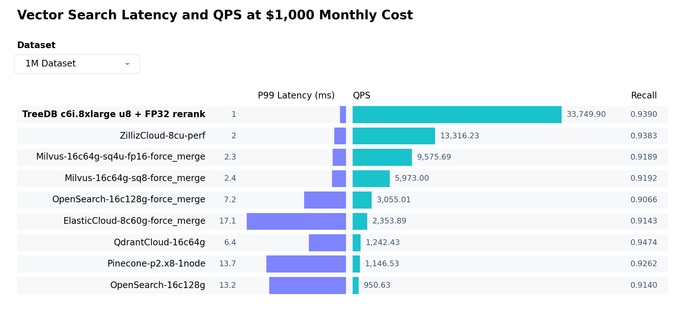
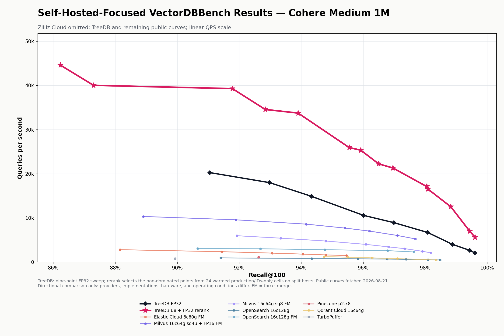

# TreeDB

TreeDB is a pre-alpha persistent storage engine built around a copy-on-write
B+Tree, a persistent value log, and command-WAL recovery. It includes a native
wire server, a Mongo-compatible gateway, a collection/document layer, secondary
indexes, and benchmark tooling for comparing TreeDB against MongoDB and other
engines.

TreeDB is the main focus of this repository. The repo also contains HashDB, an
older mmap-backed hash engine used for experiments and comparison; see
`HashDB/README.md`.

## Status

TreeDB is pre-alpha:

- APIs and on-disk formats may change without backward-compatibility guarantees.
- New binaries may intentionally reject old DB directories.
- Benchmark DB directories should be rebuilt from scratch unless a report says
  otherwise.

Historical evidence and archived benchmark results under
`TreeDB/docs/evidence`, `docs/evidence`, `TreeDB/docs/benchmarks`, and
`docs/benchmarks` are kept in Git. Those archives have separate module
boundaries so runtime Go module downloads remain below Go's 500 MiB source
archive limit. Clone the repository to inspect the complete archives.

## What TreeDB Provides

- Persistent B+Tree index with copy-on-write root publishing.
- Persistent value log for large values and leaf/value placement experiments.
- Command WAL for collection and raw-key redo/recovery.
- Snapshot-isolated readers and exclusive process-level DB directory locking.
- Collection/document APIs with BSON, template-v1, secondary indexes, and vector
  search experiments.
- Native wire protocol through `cmd/treedb-native-server`.
- Mongo-compatible gateway through `TreeDB/mongo_gateway`.
- Benchmark and profiling scripts for YCSB, collections, vector search, and
  storage-engine comparison.

## Quickstart

Build the primary TreeDB servers:

```sh
mkdir -p bin
go build -o bin/treedb-native-server ./cmd/treedb-native-server
go build -o bin/treedb-mongo-gateway ./TreeDB/mongo_gateway/server.go
```

Run the native server:

```sh
./bin/treedb-native-server \
  -dir /tmp/treedb-native \
  -profile command_wal_durable \
  -addr 127.0.0.1:17130
```

The native server and `cmd/treedb-document-service` use the shared COW document
owner by default. New vector indexes default to cosine/float32 `column_graph`,
the only supported serving strategy. Removed strategies, L2/inner-product ANN,
primary int8 vector indexes and BSON vector-index declarations are refused before
mutation. Mongo BSON CRUD and scalar indexes remain supported; Mongo vector
`createIndexes` requests return `BadValue` (code 2) without creating a collection
or any indexes, including scalar siblings in the same request.
Ordinary filtered ANN and vector-bearing filtered Hybrid are unavailable;
request `route=exact` explicitly for ordinary filtered dense search. Admitted
typed filtering and derived quantized score planes retain their own contracts.
Ordinary ColumnGraph requires
`command_wal_durable` under both storage owners. After deferred or raw wire vector
mutations, keyword and filtered exact reads remain available, while ANN/mixed
Hybrid require explicit graph maintenance. The HTTP service exposes Optimize;
the standalone wire server requires orderly shutdown, public owner/API Optimize
against the same directory, then restart. Flush/Checkpoint do not rebuild graphs.
Use `-legacy-storage` for a process that serves specialized typed or
normalized/quantized routes. This is an explicit
storage choice; unsupported requests do not fall back automatically. See the
[command ownership contract](TreeDB/docs/document-service-native-constructor.md#command-storage-owner).

Run the Mongo-compatible gateway:

```sh
./bin/treedb-mongo-gateway \
  -dir /tmp/treedb-mongo \
  -profile command_wal_durable \
  -document-format bson \
  -addr 127.0.0.1:27130
```

Minimal Go usage:

```go
package main

import (
	"fmt"
	"log"

	treedb "github.com/snissn/gomap/TreeDB"
)

func main() {
	opts := treedb.OptionsFor(treedb.ProfileCommandWALDurable, "./my-db")
	db, err := treedb.Open(opts)
	if err != nil {
		log.Fatal(err)
	}
	defer db.Close()

	if err := db.Set([]byte("key"), []byte("value")); err != nil {
		log.Fatal(err)
	}
	value, err := db.Get([]byte("key"))
	if err != nil {
		log.Fatal(err)
	}
	fmt.Println(string(value))
}
```

## Profiles

The current public TreeDB profile surface is intentionally small:

- `command_wal_durable`: recommended server default; ordinary acknowledgements
  wait for a durable dependency-closed command-WAL prefix.
- `command_wal_relaxed`: ordinary acknowledgements are relaxed, while every
  explicit `*Sync` waits for a durable dependency-closed command-WAL prefix.
- `no_wal_fast`: production no-WAL profile; ordinary acknowledgements are
  relaxed and every explicit `*Sync` waits for a sealed durable root.
- `bench_unsafe`: benchmark/test-only ceiling with no durability promise. It is
  available only through the explicit benchmark constructor/parser boundary.

All three production profiles verify value-log integrity. `Flush` is a
visibility/drain operation, not a durability boundary. `Checkpoint` and clean
`Close` wait for a sealed durable root.

Legacy Go aliases are retained only for compatibility and focused low-level
tests. CLI and environment parsers accept only canonical underscore names.

More detail: `docs/TREEDB_PROFILES.md` and `docs/TREEDB_WRITE_PATHS.md`.

## Benchmarking

These checked-in reports use different workloads, profiles, and caveats. Treat
each workload as scoped evidence from its linked benchmark, not as one combined
benchmark suite.

### TreeDB versus Qdrant: same-machine 500K vectors

November 26 post-Sprint 16 comparison on `mikers-B560-DS3H-AC-Y1` (`i5-11400F`,
Linux `x86_64`, commit `e78d8b40a`) with a shared six-CPU budget: 500K
768-dimensional cosine vectors, `topK=10`, and document payloads **without
vectors**. End-to-end Python clients use TreeDB native-v4 and Qdrant 1.19.0
gRPC (`qdrant-client 1.20.0`). Numbers are medians of six counterbalanced warm
10-second windows per configuration (`0` query errors across all 36 windows).

| System/query configuration | Recall@10 | One-client QPS | Six-client QPS |
| --- | ---: | ---: | ---: |
| TreeDB SQ8 + packed FP32 rerank (`ef=128`) | 97.50% | 1,040.8 | 2,521.5 |
| Qdrant SQ8 + FP32 rescore (`ef=128`) | 95.55% | 873.9 | 2,196.5 |
| Qdrant FP32 search reference (`ef=128`) | 95.70% | 707.3 | 1,619.4 |

At independently selected settings exceeding 95% recall, TreeDB delivered
**19.1% more one-client QPS and 14.8% more six-client QPS than Qdrant SQ8**
(at `97.50%` vs `95.55%` recall@10). Achieved recalls are not identical. This is
scoped application throughput on a shared workstation, not maximum server
throughput or an official 1M benchmark; the FP32 reference uses the same
SQ8-equipped Qdrant collection. See the
[November 26 README benchmark refresh](docs/benchmarks/readme_benchmark_refresh_2026-11-26.md#11-treedb-versus-qdrant-same-machine-500k-vectors)
(prior Ryzen 7 9700X [September 17 TreeDB/Qdrant report](docs/benchmarks/treedb_vs_qdrant_cohere500k_2026-09-17.md))
for latency, repeat ranges, configurations, dataset provenance, and limitations.

### VectorDBBench Cohere 1M

End-to-end VDBBench search on Cohere Medium 1M (768-dimensional cosine,
`topK=100`, IDs-only responses), with separate c6i.8xlarge client and server
hosts. The budgeted TreeDB server was 32 vCPUs and 64 GiB at exactly
$1,000/month. The two canonical TreeDB curves are FP32 HNSW traversal and
scalar-u8 traversal with FP32 reranking.





| TreeDB curve | about 0.98 recall | about 0.994 recall | highest measured recall |
| --- | ---: | ---: | ---: |
| u8 + FP32 rerank | 16,532 QPS @ 0.9809 | 6,969 QPS @ 0.9944 | 5,626 QPS @ 0.9961 |
| FP32 | 6,709 QPS @ 0.9808 | 2,649 QPS @ 0.9944 | 2,093 QPS @ 0.9960 |

The public curves are a directional leaderboard overlay, not same-hardware
reproductions. Full methodology, latency, profiles, supporting quantized-only
measurements, raw data, and evidence archive:
[August 21 Cohere 1M report](docs/benchmarks/treedb_vectordbbench_cohere1m_c6i_dense_curve_2026-08-21.md).

### YCSB Server Workload

The November 26 post-Sprint 16 comparison on `mikers-B560-DS3H-AC-Y1`
(`i5-11400F`, Linux `x86_64`, commit `e78d8b40a`) uses the public Mongo BSON
API, the external `go-ycsb` client, 100,000 records, 10,000 operations, 16
workers, uniform keys, 95% reads / 5% updates, and `--network host` loopback
parity for Docker MongoDB 8.2.7. Three alternating fresh fixtures per arm
(AB/BA/AB) have zero operation errors. Run medians and the median of paired
GoMap/MongoDB ratios are:

| ACK class | MongoDB 8.2.7 ops/s | GoMap Mongo gateway ops/s | Paired ratio |
| --- | ---: | ---: | ---: |
| Relaxed: both `w:1`, `j` absent | 27,333.4 | 74,649.3 | 2.744788 (+174.48%) |
| Durable-B: requests differ | 21,381.7 | 35,471.1 | 1.784305 (+78.43%) |

Durable-B uses MongoDB `w:1,j:true` versus GoMap's ordinary
`command_wal_durable` ACK with `w:1`, `j` absent. Load uses `w:1`, `j` absent
on both engines (median load: `48,013.7` vs `33,825.2 ops/s` in Relaxed;
`48,849.7` vs `2,324.8 ops/s` in Durable-B, where GoMap's durable load waits on
stable command-WAL dependencies). These short, cache-warmed runs are scoped
workstation evidence, not a sustained or durability-equivalence claim. Full
per-pair numbers, latencies, and methodology:
[November 26 README benchmark refresh](docs/benchmarks/readme_benchmark_refresh_2026-11-26.md#1-ycsb-server-workload)
(prior [October final-source YCSB report](docs/benchmarks/ycsb_mongodb_gomap_final_2026-10-30.md)).

Historical June results used different whole versions and fixture/runtime
conditions. The MongoDB URI requested `w:1` with `j` absent; it is not a
journal-before-ACK baseline. The three June repeats reused one loaded database.
Keep those numbers separate from the fresh-fixture comparison above:

| Historical June target | profile | load ops/sec | run ops/sec | run avg us | run p99 us |
| --- | --- | ---: | ---: | ---: | ---: |
| MongoDB 8 | `w:1`, `j` absent | 38,755.4 | 26,494.1 | 595.0 | 1,275.0 |
| TreeDB nativewire | `command_wal_durable` | 83,217.0 | 135,318.6 | 113.0 | 367.0 |
| TreeDB Mongo gateway | `command_wal_durable` | 68,218.2 | 80,628.4 | 199.0 | 649.0 |

[June 3 historical YCSB report](docs/benchmarks/ycsb_latest_main_2026-06-03.md)
retains its original commands, repeats and limitations.

### Indexed Collection Insert Workload

Two secondary indexes, November 26 post-Sprint 16 benchmark refresh
(`i5-11400F`, commit `e78d8b40a`, `-count 3` medians), `100000` documents,
batch size `16000`, and `command_wal_relaxed` for TreeDB. `docs/sec` is the
timed insert measurement for the value-log outer-leaf layout. Compacted B/doc
uses `exhaustive_compact` for TreeDB template-v1 (`25.2` B/doc
`full_leafgen_pack_gc`; `68.8` B/doc offline compact), `full_leafgen_pack_gc`
for TreeDB BSON and JSON, and SQLite after `VACUUM`.

| engine / format | layout | docs/sec | compacted B/doc |
| --- | --- | ---: | ---: |
| TreeDB template-v1 | data and index outer leaves in value log | 657,030 | 26.5 |
| TreeDB BSON | data and index outer leaves in value log | 612,370 | 28.0 |
| TreeDB JSON | data and index outer leaves in value log | 506,329 | 36.3 |
| SQLite native columns | WAL normal | 372,949 | 156.7 |
| SQLite JSON | WAL normal | 312,858 | 231.7 |

Source:
[November 26 README benchmark refresh](docs/benchmarks/readme_benchmark_refresh_2026-11-26.md#2-indexed-collection-insert-workload)
(prior [June 17 full benchmark refresh](docs/benchmarks/full_benchmark_report_2026-06-17.md)).

### Collection Read And Lookup Workload

Two secondary indexes, November 26 post-Sprint 16 collection/SQLite matrix
(`i5-11400F`, commit `e78d8b40a`, `command_wal_relaxed`, batch size `16000`,
data and index outer leaves in value log).

| operation | TreeDB template-v1 ops/sec | TreeDB JSON ops/sec | SQLite native columns ops/sec | SQLite JSON ops/sec |
| --- | ---: | ---: | ---: | ---: |
| Primary read | 1,098,780 | 1,034,768 | 242,014 | 310,655 |
| Unique secondary lookup | 604,230 | 586,166 | 313,873 | 287,109 |
| Nonunique secondary lookup | 211,506 | 214,961 | 45,455 | 26,922 |

Source:
[November 26 README benchmark refresh](docs/benchmarks/readme_benchmark_refresh_2026-11-26.md#3-collection-read-and-lookup-workload)
(prior [April 27 collection/SQLite matrix](docs/benchmarks/collections_rewrite_vacuum_matrix_pr1075_2026-04-27.md)).

### Collection Concurrency Workload

The collection insert/read/lookup rows above are single benchmark-driver rows.
For concurrent collection-layer reads and mixed read/write evidence, use the
separate concurrency runner. In the November 26 post-Sprint 16 run
(`i5-11400F`, commit `e78d8b40a`, `GOMAXPROCS=12`, `command_wal_relaxed`, two
secondary indexes), TreeDB template-v1 primary reads into a caller buffer
measured `202.6 ns/op` (`4.94M ops/sec`, `0 B/op`, `0 allocs/op`), parallel
unique secondary lookups measured `296.1 ns/op` (`3.38M ops/sec`, `3 allocs/op`),
and saturated mixed primary reads with one writer measured `4.95M reader ops/sec`
(`202.1 ns/op`) and `18.2k writer docs/sec`. Under fixed-read-load pacing
(`128`-doc writer batches, medians of 5), writer throughput reached `275.9k`
docs/sec at `500k` reads/sec and `223.3k` docs/sec at `1.50M` reads/sec (`2.5 us`
p50 read).

Source:
[November 26 README benchmark refresh](docs/benchmarks/readme_benchmark_refresh_2026-11-26.md#4-collection-concurrency-workload)
(prior [June 4 collection concurrency report](docs/benchmarks/collections_concurrency_main_2026-06-04.md)).

### Typed Metadata Mutation Workload

November 26 run on `mikers-B560-DS3H-AC-Y1` (`i5-11400F`, commit `e78d8b40a`),
pinned to two CPUs with `GOMAXPROCS=2`: 128 existing typed documents,
8-dimensional vectors, and a declared metadata string update. Each sample
performs 10 complete public mutations, including validation, planning,
command-WAL encoding, and publication; setup and teardown are untimed. The
Collection API fixture uses `command_wal_durable` with fsync-on-publish. The
document-service fixture uses its test backend with command WAL enabled but
without fsync-on-publish. Vector assets are not rebuilt. Medians are from five
samples:

| public boundary | publication profile | median ns/op | batches/sec | rows/sec | B/op | allocs/op |
| --- | --- | ---: | ---: | ---: | ---: | ---: |
| Collection API | durable, fsync-on-publish | 18,208,476 | 54.92 | 7,030 | 1,505,976 | 10,959 |
| Document service | test backend, no fsync-on-publish | 14,122,493 | 70.81 | 9,064 | 1,339,100 | 9,601 |

The rows use different fixtures and publication profiles, so do not compare
them directly against each other. Reproduce with:

```sh
GOMAXPROCS=2 taskset -c 4,5 go test \
  ./TreeDB/collections ./TreeDB/documentservice \
  -run '^$' \
  -bench '^Benchmark(TypedMinima|ServiceTyped)MetadataMutation$/^rows128$/^dims8$' \
  -benchmem -benchtime=10x -count=5
```

### Vector Search Serving Workload

Tier S exact-FP32 no-document snapshot: `mikers-B560-DS3H-AC-Y1` (Intel Core
i5-11400F, `linux/amd64`), 2026-11-26, commit `e78d8b40a` (with the
`-tags usearch_bench` compile fix in `vector_usearch_bench_test.go`), `10000`
documents, `64` dimensions, `M=16`, `efConstruction=128`, `efSearch=128`,
`topK=10`, query stream length `16`, `BENCHTIME=1000x`, and `COUNT=3`. TreeDB
rows use warmed persisted `column_graph` / `hnsw_search_pack_v1` no-document
routes. USearch (`v2.25.2`) rows are pure in-memory external ANN baselines, not
persistence-equivalent storage rows.

| row | cpu | median ns/op | derived ops/sec | B/op | allocs/op |
| --- | ---: | ---: | ---: | ---: | ---: |
| TreeDB `Collection.SearchVectorIndexWithBuffer` | 1 | 65,908 | 15,173 | 0 | 0 |
| TreeDB `OpenVectorIndexSearcher` + `SearchWithBuffer` | 1 | 65,378 | 15,296 | 0 | 0 |
| TreeDB `OpenVectorIndexSearcher` + `SearchWithBuffer` parallel row | 8 | 10,167 | 98,357 | 0 | 0 |
| USearch `Search` | 1 | 79,980 | 12,503 | 136 | 3 |
| USearch `SearchParallel` | 8 | 11,819 | 84,610 | 136 | 3 |

Source and reproduction workflow:
[November 26 README benchmark refresh](docs/benchmarks/readme_benchmark_refresh_2026-11-26.md#6-vector-search-serving-workload)
and [TreeDB vs USearch vector benchmark workflow](TreeDB/docs/guides/vector-search-benchmark-workflow.md).
API chooser, route guardrails, and runnable exact-only demo:
[high-QPS collection vector-search guide](TreeDB/docs/guides/vector-search-high-qps-collection-api.md)
and [`cmd/treedb_vector_highqps_demo`](cmd/treedb_vector_highqps_demo/README.md).

### TreeDB Mongo Gateway Client-Shape Workload

November 26 post-Sprint 16 run (`i5-11400F`, commit `e78d8b40a`):
gateway-shaped BSON documents, `200000` documents, batch size `1000`, 16 insert
producers, two secondary indexes (`email`, `city`), TreeDB `command_wal_relaxed`
(standalone COW), settled read state, and 16 concurrent readers for the read
phases. This benchmark keeps TreeDB storage constant while changing the
client/protocol boundary.

| TreeDB access path | load docs/sec | concurrent `_id` reads/sec | concurrent indexed `email` reads/sec | `_id` p95 us | `email` p95 us |
| --- | ---: | ---: | ---: | ---: | ---: |
| Direct collection API | 371,930 | 1,447,011 | 550,218 | 18 | 110 |
| Mongo raw wire over TCP | 402,560 | 234,285 | 192,711 | 103 | 125 |
| TreeDB native wire over TCP | 350,096 | 93,901 | 105,634 | 280 | 231 |
| Mongo driver raw command | 364,605 | 115,848 | 107,077 | 217 | 229 |
| Mongo driver command | 377,490 | 120,807 | 113,793 | 209 | 213 |
| Mongo driver CRUD | 336,105 | 106,443 | 113,382 | 237 | 215 |

`Direct collection API` is the TreeDB collection/storage ceiling, not a
Mongo-compatible protocol row. TreeDB rejects unacknowledged `w:0` writes
before mutation, so `driver-unack` is excluded. On the same run, TreeDB
post-load physical `du` measured `15.47–15.51 MiB` (`81.1–81.3 B/doc`) versus
Docker MongoDB 8.2.7 `driver` physical `du` `218.90 MiB` (`1,147.7 B/doc`,
`0.07x`). Use this table to compare TreeDB access-path overhead; compare
against MongoDB only when client mode and acknowledgement semantics match.

Source:
[November 26 README benchmark refresh](docs/benchmarks/readme_benchmark_refresh_2026-11-26.md#7-treedb-mongo-gateway-client-shape-workload)
(prior [June 4 fast Mongo/native client-shape matrix](docs/benchmarks/mongo_gateway_fast_client_matrix_2026-06-04.md)).

### Mongo API Full-Sweep Workload

November 26 post-Sprint 16 benchmark refresh (`i5-11400F`, commit `e78d8b40a`),
Docker MongoDB 8.2.7 baseline, `100000` BSON documents, TreeDB Mongo gateway
`driver-command-raw`, `command_wal_relaxed`, standalone COW open mode. The
full-sweep load rows include the additional `age_1` range index even when the
displayed secondary-index count is `0`. TreeDB physical MiB is the post-sweep
`checkpoint` physical `du` (after `480,000+` concurrent updates, prior to
offline `exhaustive` compaction; `0.09x–0.47x` MongoDB physical `du`).

| secondary indexes | TreeDB load docs/sec | MongoDB load docs/sec | TreeDB `_id` r16 ops/sec | MongoDB `_id` r16 ops/sec | TreeDB physical MiB | MongoDB physical MiB |
| ---: | ---: | ---: | ---: | ---: | ---: | ---: |
| 0 | 292,742 | 411,559 | 118,446 | 35,711 | 18.97 | 213.38 |
| 1 | 276,414 | 243,760 | 124,489 | 33,685 | 101.80 | 216.99 |
| 2 | 239,582 | 183,053 | 125,480 | 37,014 | 102.19 | 217.56 |

In the same run, TreeDB indexed `age` range reads (`r16`) measured `98,356` /
`88,947` / `105,341 ops/sec` (`3.43x–4.19x` MongoDB 8.2.7) and concurrent `_id`
`updateOne` scaling reached `52,272–53,846 ops/sec` at 16 writers (`1.54x–1.60x`
MongoDB) and `70,526–72,159 ops/sec` at 32 writers (`2.00x–2.12x` MongoDB).

Source:
[November 26 README benchmark refresh](docs/benchmarks/readme_benchmark_refresh_2026-11-26.md#8-mongo-api-full-sweep-workload--writer-scaling)
(prior [June 17 full benchmark refresh](docs/benchmarks/full_benchmark_report_2026-06-17.md)).

### Vector Search Server Matched-Recall Matrix

Current-main Linux/amd64 snapshot for deterministic `100k` and `250k`, 128d
cosine top-10 corpora. Each row selects the lowest tested `efSearch` whose
median recall@10 is at least `.90`; each cell is the median of three serialized,
counterbalanced repetitions with 1,000 measured queries. Search QPS excludes
index construction.

| system | corpus | selected EF | recall@10 | c=1 QPS / p95 | c=32 QPS / p95 |
| --- | ---: | ---: | ---: | ---: | ---: |
| TreeDB single daemon / four groups | 100k | 64 | .9525 | 2,198.0 / 0.537 ms | 10,852.5 / 4.866 ms |
| pgvector | 100k | 64 | .9251 | 1,255.6 / 0.965 ms | 3,745.6 / 15.390 ms |
| Milvus Standalone | 100k | 64 | .9210 | 644.8 / 1.931 ms | 2,256.7 / 25.410 ms |
| TreeDB single daemon / four groups | 250k | 128 | .9580 | 1,525.3 / 0.791 ms | 6,220.6 / 8.466 ms |
| pgvector | 250k | 128 | .9229 | 385.5 / 3.580 ms | 1,712.9 / 36.690 ms |
| Milvus Standalone | 250k | 128 | .9336 | 559.8 / 1.997 ms | 2,141.3 / 26.670 ms |

TreeDB uses one OS daemon with one public coordinator and four logical serving
groups; pgvector uses one PostgreSQL container; Milvus uses Standalone plus
etcd and MinIO. Full EF curves, repetition ranges, topology, resource controls,
and caveats are in the
[August 12 matched-recall report](docs/benchmarks/treedb_vector_server_matched_recall_2026-08-12.md)
and its [machine-readable result](docs/benchmarks/treedb_vector_server_matched_recall_2026-08-12.json).

On November 26 (`e78d8b40a`, same `i5-11400F` host, same pinned
`pgvector/pgvector:pg16` and `milvusdb/milvus:v2.6.20` containers), running the
checked-in `scripts/bench_vector_db_compare.sh` harness (`M=16`,
`efConstruction=128`, 1,000 queries) refreshed **in-process** TreeDB
`column_graph` HNSW (`treedb_vector_search_demo`) against containerized
PostgreSQL+pgvector and Milvus Standalone on the deterministic clustered
`100k`/`250k` 128d cosine corpora:

| system (Nov 26 `bench_vector_db_compare.sh`) | corpus | EF | recall@10 | c=1 QPS / p95 | c=32 QPS / p95 | storage |
| --- | ---: | ---: | ---: | ---: | ---: | ---: |
| TreeDB `column_graph` HNSW (in-process) | 100k | 64 | .9978 | 9,313.7 / 0.131 ms | 42,183.3 / 0.371 ms | 163.48 MB |
| PostgreSQL+pgvector (`pg16`) | 100k | 64 | .9985 | 1,501.6 / 0.856 ms | 5,481.6 / 10.34 ms | 137.32 MB |
| Milvus Standalone (`v2.6.20`) | 100k | 64 | .9989 | 795.6 / 1.45 ms | 2,537.2 / 22.50 ms | 206.61 MB |
| TreeDB `column_graph` HNSW (in-process) | 250k | 128 | 1.0000 | 5,095.9 / 0.242 ms | 23,051.1 / 0.711 ms | 407.42 MB |
| PostgreSQL+pgvector (`pg16`) | 250k | 128 | 1.0000 | 453.9 / 2.64 ms | 1,790.8 / 33.74 ms | 343.27 MB |
| Milvus Standalone (`v2.6.20`) | 250k | 128 | .9977 | 617.2 / 1.71 ms | 2,170.2 / 25.93 ms | 516.41 MB |

Note the measurement boundary: the November 26 table exercises in-process TreeDB
`column_graph` (`0` docs fetched, `0` fallbacks) against networked pgvector and
Milvus containers, whereas the August 12 table above measures the networked
TreeDB single-daemon / four-group server topology. See the
[November 26 README benchmark refresh](docs/benchmarks/readme_benchmark_refresh_2026-11-26.md#10-vector-search-matched-recall-comparison-bench_vector_db_comparesh)
for insert/build/reopen timings and guardrails.

TreeDB is also wired into `snissn/vectordbbench` through the document service.
Those rows measure Python/client/HTTP/service overhead and are separate from
native Go `0 B/op` no-document evidence; see the
[TreeDB VectorDBBench runbook](docs/benchmarks/treedb_vectordbbench_runbook_2026-06-11.md).

### `application.db` Offline Density Workload

Offline compacted-size comparison from the June 2 Celestia `application.db`
rerun.

| engine | compacted size | workflow |
| --- | ---: | --- |
| TreeDB | 1.690 GiB | `command_wal_relaxed`, rebuild, `CompactStorageFull`, offline index vacuum |
| PebbleDB | 2.108 GiB | snappy, 64 KiB blocks, 64 MiB target files, full compact |
| goleveldb | 2.221 GiB | snappy, 64 KiB blocks, restart interval 256, full compact |

Source:
[June 2 density rerun](docs/benchmarks/application_db_engine_matrix_2026-06-02.md).

### Indexed Text/Vector/Hybrid Insert And Search Workload

November 26 post-Sprint 16 run on `mikers-B560-DS3H-AC-Y1` (`i5-11400F`, Linux
`x86_64`, commit `e78d8b40a`, `-benchtime=5x -count=3` medians): `256` JSON
documents, scalar indexes on `tenant`/`region`, a `lexical` title/body text
index (new text indexes default to `text-v2`; `text-v1` is explicit
compatibility), and an exact cosine column graph (`dims=16`, `M=8`). The insert
row times `InsertBatch` + `Flush` + `RebuildVectorIndex`; search rows
build/index the fixture before timing and then time the search API call only.

| row | timed boundary | ns/op median | ops/sec | B/op | allocs/op | key counters |
| --- | --- | ---: | ---: | ---: | ---: | --- |
| Indexed insert/readiness | 256-doc batch insert + flush + vector rebuild | 189,824,102 | 5.27 ops/sec / 1,348.6 docs/sec | 12,472,600 | 39,866 | 45,964 insert ns/doc; 485,386 flush ns/doc; 210,148 vector rebuild ns/doc |
| Text candidates (`text-v2` default) | `SearchHybridTextCandidates`, no docs | 96,472 | 10,365.70 | 115,020 | 198 | 64 text candidates; 0 docs fetched; 0 fail/fallback |
| Text candidates (`text-v1` legacy) | `SearchHybridTextCandidates`, no docs | 197,570 | 5,061.50 | 92,825 | 632 | 64 text candidates; 0 docs fetched; 0 fail/fallback |
| Vector candidates | `SearchHybridVectorCandidates`, no docs | 36,960 | 27,056.28 | 40,256 | 82 | 64 vector candidates; 0 docs fetched; 0 fail/fallback |
| Hybrid `text-v2` + scalar filter | `SearchHybrid` lexical + scalar filter, no docs | 56,585 | 17,672.53 | 47,147 | 266 | 0 docs fetched; 0 fail/fallback |

Ordinary vector+scalar filtered Hybrid is unsupported and fails closed; current
benchmark probes verify the rejection and skip those cells without success
metrics.

Source, commands, artifact paths, guardrails, and caveats:
[November 26 README benchmark refresh](docs/benchmarks/readme_benchmark_refresh_2026-11-26.md#9-indexed-textvectorhybrid-insert-and-search-workload)
and [TreeDB indexed insertion/search benchmark](docs/benchmarks/treedb_index_insert_search_benchmarks.md).

### Benchmark tools and runbooks

The dated reports above contain their own reproduction details. Start here for
current benchmark entry points:

- `docs/benchmarks/treedb_canonical_benchmark_runbook.md`
- `docs/benchmarks/collections_canonical_benchmark.md`
- `docs/benchmarks/ycsb_mongodb_treedb_current.md`
- `scripts/ycsb_compare_mongodb_treedb.sh`
- `cmd/unified_bench/README.md`
- `cmd/benchprof/README.md`

Profile capture workflow:

```sh
OUT=$(mktemp -d /tmp/gomap_profiles_XXXXXX)
./bin/unified-bench ... -profile-dir "$OUT"
./bin/benchprof -profiles-dir "$OUT"
```

## Documentation

- TreeDB canonical spec: `TreeDB/docs/spec/README.md`
- TreeDB guides: `TreeDB/docs/guides/README.md`
- TreeDB concepts: `docs/TREEDB_CONCEPTS.md`
- TreeDB storage format: `docs/TREEDB_STORAGE_FORMAT.md`
- TreeDB recovery: `docs/TREEDB_RECOVERY.md`
- TreeDB collection quickstart: `docs/TREEDB_COLLECTION_QUICKSTART.md`
- Contracts: `docs/contracts/README.md`
- Full docs index: `docs/README.md`

## Repo Contents

- `TreeDB/`: TreeDB storage engine, collection layer, native APIs, command WAL,
  and Mongo gateway.
- `cmd/treedb-native-server/`: native wire server.
- `TreeDB/mongo_gateway/`: Mongo-compatible TreeDB gateway.
- `cmd/unified_bench/`: cross-engine benchmark harness.
- `cmd/benchprof/`: profile/result summarizer.
- `HashDB/`: mmap-backed hash-index engine used for experiments and comparison.

## Testing

```sh
go test ./...
go test ./TreeDB/... ./cmd/treedb-native-server ./TreeDB/mongo_gateway
```

For large benchmark runs, prefer a fresh DB directory and record the exact
commit, host, profile, command, and artifact path in the report.
