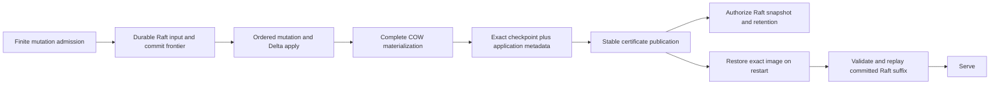

# Raft-owned recovery and certified TreeDB checkpoints

Status: opt-in prototype, not a production durability or performance certification.
Source baseline: Gomap `fc3c3db97ec2954d47a1adf731d501e7b73f181f`,
Dgraph `b87e967bc3c18d4c609e652d79c7ccb8e94ace1b`.

## Selected architecture

Dgraph's authoritative recovery input is its durably retained Raft history plus
a certified TreeDB checkpoint. The posting database is a materialization of that
history. It does not independently log and sync each posting commit. Standalone
TreeDB continues to provide its ordinary `WriteSync` contract.

The complete intended pipeline is:

1. Admit finite work under memory, pending-transaction and recovery-debt budgets.
2. Persist Raft entries and the required HardState/commit frontier before apply.
3. Apply normal mutations and transaction decisions in semantic Raft order,
   preserving MVCC timestamps and complete posting/index visibility cuts.
4. Install each complete COW cut. The existing client RPC contract remains the
   same: its ACK must not be relabeled as a posting-store sync completion.
5. At a semantic barrier, capture one data root and matching application metadata.
   Stabilize its entire physical resource closure and publish its certificate.
6. Only then authorize Raft snapshot advancement and reclamation through that
   application frontier. Publication failure never authorizes reclamation.
7. On restart restore exactly that certified data image, validate its identity
   and Raft history coverage, then replay committed entries strictly after it.
   Do not serve until replay has reached the recovered commit frontier.



The checkpoint is the joint application/storage boundary. An independent applied
index file is insufficient: its index could survive while the corresponding root
does not, or a newer root could survive while its progress marker does not.

## What the prototype implements

`OpenExternalRecovery` is a distinct owner capability. It requires explicit
`no_wal_fast` and `cow_ordered`, a stable owner identity, exclusive directory
ownership, and a fresh directory or matching existing owner marker. It refuses an
ordinary populated directory. `Open` refuses the external owner directory.
Mutation callbacks run through `ExternalRecovery.Apply`; checkpoint/Close exclude
them. The caller must already own durable command authority and must not allow
asynchronous mutations to escape a callback. `DB()` exposes existing TreeDB/MVCC,
not another publication implementation.

The first implementation deliberately reuses maintained physical snapshot cuts
and root rebinding. It does not invent a second root format or a speculative
publisher. TreeDB's persistent value log remains part of the checkpoint image;
old segments are never discarded because of age.

Directory layout:

```text
external-recovery.json          version and owner identity
EXTERNAL.LOCK                  exclusive materialization owner
working/                       disposable TreeDB working database
checkpoints/<generation>/db/    immutable exact physical snapshot
checkpoints/<generation>/certificate.json
CURRENT                        generation and certificate digest
```

Certificates bind the persistent root token, opaque application metadata, full
file inventory, sizes and SHA-256 hashes. The process-local leaf-generation view
version is excluded from persistent identity. Snapshot index metadata is emitted
from the maintained captured cut, not copied from mutable live metadata. Physical
file identities are rebound using the existing snapshot restore implementation.
Files and directory edges are stabilized before atomic generation and CURRENT
publication. The current and preceding immutable generations are retained.

Recovery verifies the entire CURRENT image before touching disposable working
state. It always recreates working state from the certificate, even after a
clean Close or a later incidental working checkpoint. Without a certificate it
starts at genesis and requires retained history from genesis. Corruption, wrong
identity, incompatible versions and history gaps fail closed. There is no silent
fallback to a stale image or independently flushed working suffix.

The Dgraph branch's explicit selector is
`backend=treedb;tier=benchmark_minimal;durability=raft_checkpoint;events=true`.
It requires Alpha filesystem survival; validation also starts Zero with
`--survive=filesystem`. The posting adapter uses existing relaxed MVCC commits
inside the external-owner capability. Raft Ready persistence precedes scheduling
committed application work, including commit-only Ready batches.

Application metadata includes group/Raft identity, applied index/term, Oracle
maximum assigned timestamp, group checksum, configuration state and application
version. The supported checkpoint cut has no pending transactions. The prototype
retains prewrites and decisions in Raft until a pending-free cut can be certified.
It pauses new mutations at bounded entry/byte recovery debt while allowing
transaction decisions to resolve pending work. Peer snapshot transfer, membership
changes, destructive/admin proposals, index rebuilds and unsupported maintenance
are rejected or disabled. Fresh plain scalar/UID schema is supported.

## Shared standalone commit path

The companion captured-prefix implementation preserves standalone durability.
Singletons and groups use the existing collector with immediate dispatch. Under
append authority it captures a complete WAL prefix, exact segment identities and
resource dependencies; it releases public append/COW writer gates before the
captured WAL fsync. Successors can append and install complete COW cuts while that
sync is blocked. Completion acknowledges only the captured LSN, even if later bytes
became stable incidentally. File/rotation pins survive until completion; Close
waits for those pins. Ambiguous sync failure poisons the handle and wakes waiters.

Existing V2 durable markers imply earlier external dependencies were already
stable when the marker was appended. Their sync and required pre-marker rotation
ordering therefore remain inside capture authority. Moving those operations out
requires a recovery-format change; this prototype does not pretend otherwise.

## Validation and architecture completion plan

Prototype validation must include public-path blocked-fsync overlap and exact ACK,
failure poisoning, rotation with persistent pointers, Close pinning, exact-image
restoration after a newer flushed working suffix, checkpoint publication crash
cuts, identity/corruption refusals, retention guards, and real Dgraph
mutation/Delta replay. A live server must also recover acknowledged state after
SIGKILL from a retained Raft suffix beyond its certificate. SIGKILL is a process
crash test, not a physical power-cut simulation.

The following work remains necessary for the complete production architecture:

| Obligation | Final design and acceptance |
| --- | --- |
| Checkpoint scaling | Persistently retain the exact existing COW root and closure, with incremental snapshot/export and bounded old-root retirement. Reuse root-publication resource ownership. Checkpoint work should follow changed resources, not total database size. Prove closure survives GC/rewrite/reopen before removing image-copy fallback. |
| Pending transactions | Either preserve this pending-free policy with measured bounded admission/recovery, or certify complete pending/prewrite/oracle state together. Never drop older prewrites while keeping only later decisions. Prove long transactions cannot create unlimited history or deadlock decisions. |
| Full semantic surface | Version and replay schema/index rebuild, deletion/admin, restore, CDC and maintenance semantics. Transfer an exact certificate/image and matching Raft suffix before enabling peer snapshots or membership changes. |
| Publication failure | Exercise every stable-file, directory, rename, root identity and Raft snapshot cut with a modeled power-loss image. Corrupt/missing input must refuse startup. Test ambiguous completion and retries without premature retirement. |
| Resource equilibrium | Bound queued requests, image/retained log bytes, pinned roots, temporary capture targets and shutdown. Prove sustained write/checkpoint/replay/retirement equilibrium at representative database sizes. |
| Visibility and ACK | Verify current RPC, Zero decision, Alpha Raft, apply and Oracle boundaries on exact code. Preserve conflict/abort/read-your-writes behavior; independently test group and leader failures. |
| Performance | Compare exact-source matched durability/workload boundaries against ordinary COW TreeDB and Badger; collect latency, CPU, allocations, peak/resident memory, checkpoint pause, recovery time, retained bytes and sync counts. Keep process-survival, filesystem-survival and diagnostic runs separate. |
| Integration | Review the integrated capability matrix, update canonical contracts and harness labels, pass exact-head CI/review and agreed performance gates, then merge topologically. A prototype pass does not satisfy earlier promotion gates. |

The current image-copy checkpoint is O(database image), holds the semantic apply
barrier, hashes the image, and copies/rebinds again on recovery. It is intentionally
limited to 8 GiB/8192 files by default. This validates the recovery contract; it is
not the final checkpoint performance design. Background GC/rollup/prune are
disabled in the Dgraph prototype, so it has no sustained maintenance-equilibrium
claim. Standalone full dependency-I/O overlap is likewise incomplete.

Fresh-directory initialization must be exclusive across recovery policies.
`EXTERNAL.LOCK` excludes external owners and the marker rejects later ordinary
opens, but the marker check is not an atomic ownership transition with an
ordinary Open that began before initialization. The prototype driver creates a
private directory and has one initializer. A shared initialization lock is a
production integration requirement. Cancellation during copying is checked
between dependency files, so an individual large-file copy can delay cancellation.

Use the Dgraph branch's `worker/treedb/raftcheckbench/run.py` for a reproducible
diagnostic workload and SIGKILL/restart check. Its separate result schema must not
be pooled into the existing durable/relaxed promotion matrix. The task report
records exact final commits, commands, all successful/failed attempts and measured
limits. No main merge is authorized by this prototype request.
